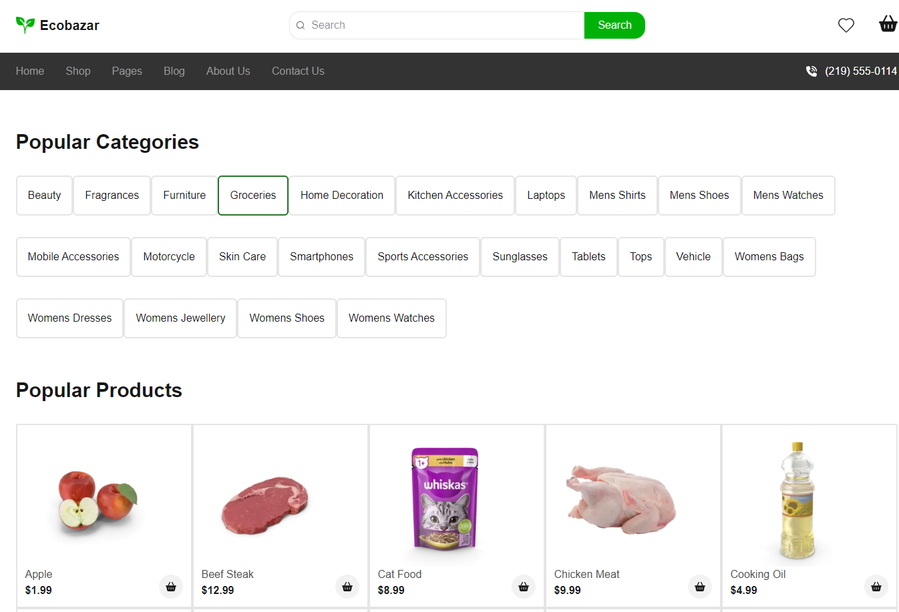

# 🛒 Ecobazar

Интернет-магазин эко-товаров на Next.js.

## 🌐 Демо

👉 https://joyl-script.github.io/next-syte/

## 🛠 Технологии

- Next.js
- [React / Redux Toolkit / TanStack Query]
- [CSS-подход: Tailwind / Sass / CSS Modules?]

## ⚙️ Функционал

-  Каталог товаров
-  Карточка товара
-  Корзина
-  Фильтрация / поиск


## 📸 Скриншоты



## 🚀 Запуск локально

```bash
git clone https://github.com/joyl-script/next-syte.git
cd next-syte
npm install
npm run dev
```

Открыть [http://localhost:3000](http://localhost:3000)

